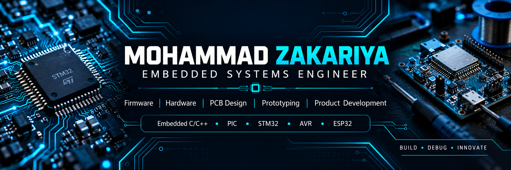

# Mohammad Zakariya
### Embedded Systems Engineer | Firmware • Hardware • PCB Design

**From firmware to functional prototype — building practical embedded systems.**

[LinkedIn](https://linkedin.com/in/mohammad-zakariya-3a2748279) ·
[Email](mailto:mzakariya0007@gmail.com) ·
[All repositories](https://github.com/mohammadzakariya07?tab=repositories)

---

## About Me

I develop and debug microcontroller-based systems with a focus on **Embedded C/C++, firmware development, hardware interfacing, PCB design, prototyping, and product development**.

- **Firmware:** Embedded C/C++, peripheral interfacing, debugging, EEPROM data persistence
- **Microcontrollers:** PIC, STM32, AVR, Arduino, ESP32
- **Communication:** UART, I²C, SPI
- **Peripherals:** GPIO, timers, interrupts, PWM, ADC, sensors, displays, relays
- **Hardware & PCB:** Circuit design, schematic capture, PCB design, simulation, and prototype testing
- **Tools:** MPLAB X IDE, STM32CubeIDE, Arduino IDE, KiCad, EasyEDA, Proteus

📍 Faridabad, Haryana, India

## Technology Stack

  
  
  
  
  
  
  
  
  
  
  

---

## Latest Public Repositories

<!-- LATEST_REPOS_START -->
| Repository | Description | Language | Last updated |
|---|---|---|---|
| [mohammadzakariya07](https://github.com/mohammadzakariya07/mohammadzakariya07) | — | Python | 2026-10-15 |
| [mohammad-zakariya-portfolio__](https://github.com/mohammadzakariya07/mohammad-zakariya-portfolio__) | mohammad-zakariya-portfolio__ | HTML | 2026-10-02 |
| [mohammad-zakariya-portfolio](https://github.com/mohammadzakariya07/mohammad-zakariya-portfolio) | Personal portfolio of Mohammad Zakariya \| Embedded Systems Engineer | HTML | 2026-10-02 |
| [Vehicle-Emergency-Car-Assist-System](https://github.com/mohammadzakariya07/Vehicle-Emergency-Car-Assist-System) | h | — | 2026-01-29 |
| [12](https://github.com/mohammadzakariya07/12) | 12 | HTML | 2026-01-18 |
| [portfolio](https://github.com/mohammadzakariya07/portfolio) | Portfolio | HTML | 2026-01-17 |
<!-- LATEST_REPOS_END -->

---

## GitHub Statistics

> Stats cards are provided by external services, so they may occasionally be slow or unavailable. Language percentages reflect GitHub's language analysis, not necessarily your total engineering skill set.

---

## Engineering Focus

- Reliable and maintainable embedded firmware
- Low-level peripheral drivers and communication interfaces
- Hardware integration, PCB design, and prototype validation
- Debugging real-world hardware/software interactions
- Product development from concept through working prototype

**BUILD · DEBUG · INNOVATE**

*Open to embedded firmware, hardware development, PCB design, and product engineering opportunities.*

